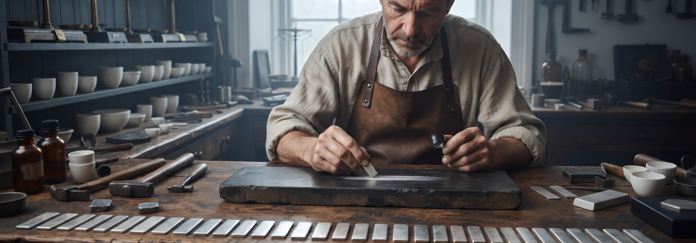

# codeintel-JWT-Misconfiguration-Checker

Title block: the name above is set in Bellota in bole red on gesso white, ruled as a studio inventory entry with the medium noted first. The small mortar mark below stands beside this first heading only. The remaining headings keep the treatment without the image, so that a long document stays quick to scan.

Scans code for common JWT (JSON Web Token) misconfigurations, such as weak signature algorithms (e.g., HS256 with insecure secret), missing expiration claims, and usage of 'none' algorithm. Validates JWT libraries configurations. - Focused on Tools for static code analysis, vulnerability scanning, and code quality assurance

> **Inventory annotation pencilled in the margin: the claim corrected.** The opening line above says the tool validates JWT library configurations. The code does not do that. PyJWT is deliberately not imported, no token is decoded, no signature is tried, and no library configuration is loaded. The search is pattern matching over file contents from beginning to end. Headings on this page read The Mortar and the Token, Five Patterns in the Grinding, The Required Target, Findings and Their Limits, Not Scanned Is Not Clean, and Exit One Means Look Again.

## Install
`git clone https://github.com/ShadowStrikeHQ/codeintel-jwt-misconfiguration-checker`

> **Inventory annotation pencilled in the margin: wrong organisation.** The install line above names ShadowStrikeHQ. The repository lives under ShadowGuard-AI, and the corrected address is https://github.com/ShadowGuard-AI/codeintel-jwt-misconfiguration-checker. The line is preserved as printed and flagged here, not corrected inside it. The README gives no directory change and no package installation after the clone, and the program runs on the standard library alone.

## Usage
`./codeintel-jwt-misconfiguration-checker [params]`

> **Inventory annotation pencilled in the margin: unusable as printed.** The usage line above omits the one argument the parser requires and cannot be run as shown. The true invocation is python3 main.py TARGET [--verbose] [--check-secrets] [--output PATH]. The target comes first and is not optional. Buttons in the kit read Scan This Target, Include the Secret Search, Save Results to a File, Show Debug Logging, and Show Help.

## Parameters
- `-h`: Show help message and exit
- `--verbose`: No description provided
- `--check-secrets`: Enable checks for hardcoded secrets.
- `--output`: Path to save results to a file.

> **Inventory annotation pencilled in the margin: A Helper Elsewhere Does Not Acquit This File.** A missing expiration finding is raised per file, and only where the file mentions jwt yet nowhere contains exp or expiration. Expiration handled in a shared helper elsewhere does not acquit a file that stays silent on the subject.

> **Inventory annotation pencilled in the margin: The Value Is Never Printed.** The secret search runs only under its flag, so a scan without that flag says nothing whatever about secrets. A weak secret finding reports only the variable name, the length of its value, and whether that value matched the predictable list. The value itself is never printed in clear, on the console or in a file. The parameter list above omits the required positional target altogether. A directory walk descends through the tree and reads only files ending in .py, .js, .java, or .go, whereas a single file handed to the program directly is read whatever its ending may be. Beside the list stands the output rule the README nowhere mentions: the file is written only when there is something to put in it, either findings or files that could not be scanned, so after a clean run no output file appears and its absence means clean rather than lost.

## License
Copyright (c) ShadowStrikeHQ

> **Inventory annotation pencilled in the margin: closing line counted.** The closing line above is the second appearance of the wrong organisation name in the file. No licence text, no licence name, and no permission terms appear in the README at all. A target that is neither file nor directory is refused with an error and exit 1. A file that cannot be read or decoded is reported by name as not scanned and also brings the run to exit 1. Any finding brings exit 1. A run with no findings and no failures prints that no JWT misconfigurations were found and exits 0.
